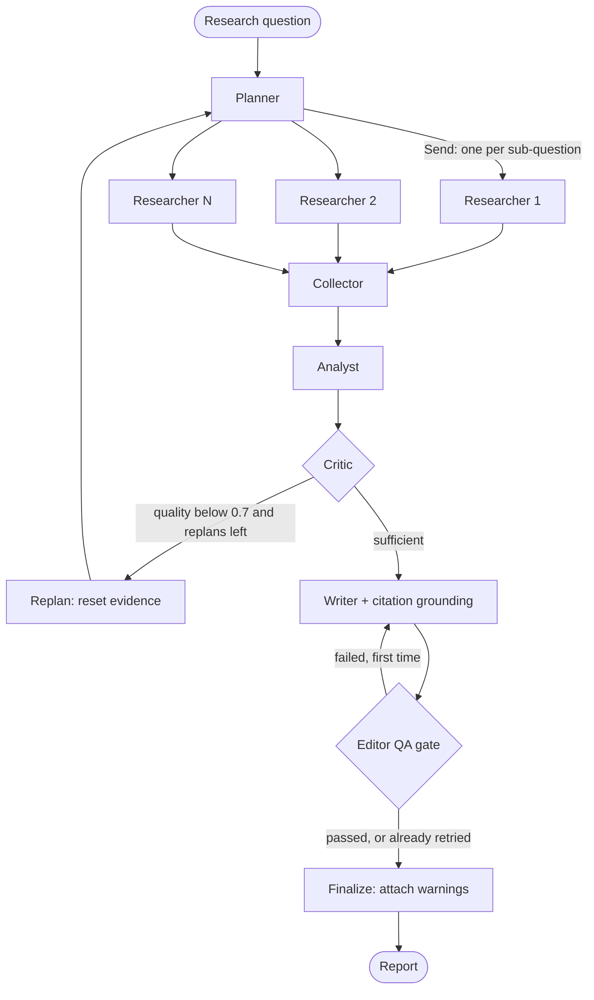

<<<<<<< HEAD
# Multi-Agent Deep Research System
=======
# Production-Ready Multi-Agent Deep Research System

>>>>>>> e09b5a98844964e1dafc368e709e7433a009514b

## Overview

A research assistant in which seven cooperating agents turn one question into a cited report. A Planner splits the question into sub-questions, one Researcher per sub-question searches the web in parallel, an Analyst synthesises the evidence, a Critic verifies claims and can send the run back for replanning, a Writer drafts the report and an Editor gates it on quality. The web UI shows every agent working in real time and lets you download the finished report as PDF, HTML or Markdown.

Built with LangGraph, FastAPI and Pydantic. The frontend is dependency-free HTML, CSS and JavaScript served by the same FastAPI app.

The project has been deployed at https://deepagentlab.vercel.app/. That URL serves whichever commit was deployed last, which may be older than this README.

## Problem Statement

A single LLM call answers a research question from memory: it cannot show its sources, it does not check its own claims, and it fails silently when its evidence is thin. This system separates the work into roles that check each other, grounds every citation in a page that was actually retrieved, and makes the whole process observable.

## Key Features

- **Parallel fan-out.** The Planner's sub-questions are dispatched with LangGraph's `Send` API, one Researcher each, running concurrently.
- **Critic-driven replanning.** If the Critic scores research quality below 0.7 and finds fixable gaps, the run loops back to the Planner with those gaps. The loop is capped (`max_replan_iterations`, default 2).
- **Editor QA gate with one retry.** A failed draft goes back to the Writer once, together with the Editor's specific objections. If it fails again the report is returned with the warnings attached.
- **Grounded citations.** After the Writer runs, any `[n]` that does not match a retrieved source is removed and the report's source list is rebuilt from the Researchers' evidence. The model cannot add a reference that was not retrieved.
- **Measured QA.** Word count, citation coverage and section completeness are computed in code and override the Editor model's estimates.
- **Live pipeline UI.** Server-Sent Events report the true start and finish of every agent, including each parallel Researcher.
- **Downloads.** PDF (print-optimised layout via the browser print dialog), a self-contained HTML document, and Markdown.
- **Human-in-the-loop (optional).** A checkpoint can pause the run for approval before analysis.
- **Provider-agnostic LLM routing.** Each agent role maps to a primary provider and fallbacks (Groq, Gemini, OpenRouter).
- **Offline mock mode.** Deterministic agent output and search results for tests, CI and UI demos, with a scripted scenario that exercises both loops.

## System Architecture

A modular monolith: one FastAPI process hosts the HTTP API, the static UI and the compiled LangGraph state machine. There is no database; run state and history live in process memory.

| Layer | Location | Responsibility |
|---|---|---|
| HTTP API | `api/main.py` | Routing, request validation, rate limiting, response shaping |
| Event stream | `utils/sse.py` | Translates graph execution into the SSE event contract |
| Orchestration | `graph/build_graph.py`, `graph/state.py` | Graph wiring, routing decisions, shared state |
| Agents | `graph/nodes/` | One module per agent |
| Quality guardrails | `utils/report_quality.py` | Evidence digest, citation grounding, measured QA |
| Export | `utils/report_export.py` | Markdown and HTML report rendering |
| Tools | `tools/` | Web search (Tavily, DuckDuckGo fallback), page fetch with SSRF guard |
| LLM access | `utils/llm_router.py`, `utils/mock_llm.py` | Role-based provider selection, mock model |
| Contracts | `schemas/` | Pydantic models for every agent's structured output |
| Frontend | `templates/index.html`, `static/` | UI |

Key decisions:

- **Single process, in-memory state.** Simplest design that meets the requirement of an interactive demo. The trade-off (no persistence, one worker) is listed under Security Considerations and Roadmap.
- **SSE over WebSockets.** Progress is one-directional, and SSE works through ordinary HTTP infrastructure.
- **Graph `debug` stream as the event source.** It emits a separate event when a node starts and when it finishes, so reported durations are measurements and parallel tasks are individually identifiable.
- **No frontend framework or third-party scripts.** The UI is small, and shipping no external script allows a `script-src 'self'` Content Security Policy.

## Architecture Diagram



When `require_human_approval` is on, the graph pauses before the Collector (after the Researchers finish) and continues on `POST /research/resume`.

## Technology Stack

| Area | Technology |
|---|---|
| Language | Python 3.11+ (CI runs 3.12) |
| Orchestration | LangGraph 1.x, LangChain core |
| API | FastAPI, Uvicorn, Starlette `StreamingResponse` (SSE) |
| Validation | Pydantic v2, pydantic-settings |
| LLM providers | Groq, Google Gemini, OpenRouter (via LangChain integrations) |
| Search and fetch | Tavily, DuckDuckGo, httpx, trafilatura |
| Frontend | HTML, CSS, JavaScript (no build step, no libraries) |
| Tests and lint | pytest, pytest-asyncio, ruff |
| Packaging | Docker, Docker Compose, Vercel (`@vercel/python`) |

## Directory Structure

```text
api/main.py              FastAPI app and routes
config/settings.yaml     Non-secret configuration
config/settings.py       Settings loader (YAML defaults, environment overrides)
graph/build_graph.py     Graph wiring and routing functions
graph/state.py           Shared state and the fan-in reducer
graph/nodes/             planner, researcher, collector, analyst, critic, writer, editor
schemas/                 Pydantic output contracts per agent
tools/                   search_tool.py, web_fetch.py
utils/sse.py             SSE event contract
utils/report_quality.py  Citation grounding and measured QA
utils/report_export.py   Markdown and HTML exporters
utils/llm_router.py      Role-based provider routing
utils/mock_llm.py        Mock model and scripted scenarios
utils/storage.py         In-memory session store
templates/, static/      Web UI
tests/                   Automated tests (offline)
evals/                   Pipeline evaluation harness and cases
```

`utils/cache.py`, `utils/memory.py` and `schemas/report_schema.py` are present but not wired into the pipeline (see Roadmap).

## Prerequisites

- Python 3.11 or newer
- An API key for at least one LLM provider (Groq, Gemini or OpenRouter). Not needed for mock mode.
- Optional: a Tavily API key. Without it, search falls back to DuckDuckGo.
- Optional: Docker

## Installation

```bash
git clone https://github.com/ayelefransi/A-production-ready-Multi-Agent-Deep-Research-System.git
cd A-production-ready-Multi-Agent-Deep-Research-System
python -m venv venv
source venv/bin/activate        # Windows: venv\Scripts\activate
pip install -r requirements.txt
cp .env.example .env            # then add your keys
```

For development and tests, install `requirements-dev.txt` instead.

## Environment Variables

Secrets are read from the environment or `.env`. Never commit `.env`.

| Variable | Required | Purpose |
|---|---|---|
| `GROQ_API_KEY` | One LLM key is required | Groq (primary provider for every role by default) |
| `GEMINI_API_KEY` | See above | Gemini (default fallback) |
| `OPENROUTER_API_KEY` | See above | OpenRouter |
| `TAVILY_API_KEY` | No | Tavily search; DuckDuckGo is used without it |
| `LANGSMITH_API_KEY` | No | LangSmith tracing when tracing is enabled |
| `LANGFUSE_PUBLIC_KEY`, `LANGFUSE_SECRET_KEY` | No | Langfuse tracing |
| `MOCK_MODE` | No | `true` returns canned agent output and search results; no network calls |
| `MOCK_LATENCY_MS` | No | Mock only: delay per agent call, to watch the UI animate |
| `MOCK_SCENARIO` | No | Mock only: `self_heal` forces one replan and one writer retry |
| `REQUIRE_HUMAN_APPROVAL` | No | `true` pauses each run for approval |
| `RATE_LIMIT_PER_MINUTE` | No | Research starts per client IP per minute (default 10, `0` disables) |
| `MAX_QUERY_LENGTH` | No | Maximum question length (default 500) |

## Configuration

Everything that is not a secret lives in `config/settings.yaml`: the model per provider, the provider and temperature per agent role, search toggles, `max_replan_iterations`, `enable_critic`, `enable_editor`, the human-approval checkpoint and the API limits. Any top-level setting can be overridden by an upper-case environment variable of the same name.

## Usage

Start the server:

```bash
uvicorn api.main:app --host 0.0.0.0 --port 8000
```

Open http://localhost:8000, type a question and press Enter. To try the UI without API keys, including both self-correction loops:

```bash
MOCK_MODE=true MOCK_LATENCY_MS=900 MOCK_SCENARIO=self_heal uvicorn api.main:app --port 8000
```

In the report view, **Download** offers PDF (choose "Save as PDF" in the print dialog), a self-contained HTML document, and Markdown.

## API Documentation

Interactive OpenAPI docs are served at `/docs`.

| Method | Path | Description |
|---|---|---|
| `GET` | `/` | Web UI |
| `GET` | `/health` | Liveness and effective configuration |
| `POST` | `/research` | Run the pipeline and return the report (blocking) |
| `POST` | `/research/stream` | Run the pipeline and stream progress (SSE) |
| `POST` | `/research/resume` | Approve or reject a paused run: `{"thread_id": "...", "action": "approve"}` |
| `GET` | `/research/history` | Session summaries, newest first (`limit` 1-200, `offset`) |
| `GET` | `/research/{thread_id}` | One session with its report |
| `DELETE` | `/research/{thread_id}` | Delete a session |
| `GET` | `/research/{thread_id}/export/markdown` | Download the report as Markdown |
| `GET` | `/research/{thread_id}/export/html` | Download the report as standalone HTML |

```bash
curl -N -X POST http://localhost:8000/research/stream \
     -H "Content-Type: application/json" \
     -d '{"query": "How is climate change affecting global coffee production?"}'
```

Request rules: `query` is 3 to 500 characters after whitespace is collapsed; `thread_id` must be a UUID. Violations return `422`. Research starts are rate limited per client IP and return `429` with `Retry-After`. Server failures return a generic message with a reference id; details go to the server log only.

SSE events: `research_start`, `agent_start`, `agent_complete`, `planner_preview`, `researcher_task_complete`, `researcher_preview`, `analyst_preview`, `critic_preview`, `replan`, `writer_preview`, `editor_preview`, `writer_retry`, `human_approval_required`, `complete`, `error`.

## Database Architecture

There is no database. `utils/storage.py` keeps sessions in a thread-safe in-process dictionary capped at `max_stored_sessions` (default 200, oldest evicted), and LangGraph checkpoints use `MemorySaver`. Both are lost on restart and are not shared between processes. A `SQLiteResearchMemory` class exists in `utils/memory.py` but is not connected to the pipeline.

## Testing

All tests run offline against the mock model and mock search.

```bash
pip install -r requirements-dev.txt
ruff check .
pytest
python evals/evaluator.py --mock
```

The suite (62 tests) covers:

- **Orchestration:** every agent runs once on the happy path; one Researcher per sub-question; source de-duplication; the replan loop, its cap and the evidence reset; the single writer retry; warnings attached after a second failure; one failing Researcher does not abort the run; routing functions.
- **API:** the SSE event contract and ordering, replan and retry events, validation, history, export, delete, pagination bounds, rate limiting, error responses that do not leak internals, and the approve and reject paths of the human-approval flow.
- **Guardrails:** removal of invalid citations, rebuilding sources from real evidence, measured QA overriding the model, the Editor's feedback reaching the Writer on retry, HTML export escaping.
- **Tools:** the SSRF guard on page fetches and offline behaviour in mock mode.

`evals/evaluator.py --mock` checks that all 22 cases produce a schema-valid report. Run without `--mock` (it uses your API quota) it also requires at least two sources and, for cases marked `replan`, that a replan happened. It measures whether the pipeline completes correctly, not the factual accuracy of the prose.

## Deployment

**Docker**

```bash
cp .env.example .env   # add keys
docker compose up --build
```

The image runs as a non-root user, exposes port 8000 and has a `/health` health check. Run a single worker and a single replica: state is in process memory.

**Vercel**

`vercel.json` routes all traffic to `api/main.py` on the Python runtime. Set the API keys as project environment variables. Limitations of a serverless target: a research run must finish within the function's maximum duration, and history and human-approval checkpoints do not survive between invocations. For long runs or the approval flow, use the container.

**CI**

`.github/workflows/ci.yml` runs ruff, the test suite and the mock evaluation on every push and pull request to `main`.

**Recovery**

The service is stateless across restarts. To recover, restart the container; there is no data to restore.

## Security Considerations

| Area | Status |
|---|---|
| Secrets | Read from the environment only; `.env` is git-ignored and excluded from the Docker build context |
| Input validation | Query length and UUID path parameters enforced by Pydantic |
| Cross-site scripting | The UI inserts all model and web text as text nodes, never as HTML. Only `http(s)` links become clickable. Exports escape all text |
| Content Security Policy | `script-src 'self'` on the UI; downloaded reports are served with a policy that permits no script |
| Server-side request forgery | Page fetches allow only `http(s)` URLs that resolve to public addresses and re-validate every redirect |
| Error handling | Clients receive a generic message and reference id; stack traces stay in the log |
| Rate limiting | Per-IP sliding window on research starts |
| Container | Non-root user |

Known gaps:

- **No authentication.** Anyone who can reach the service can start runs, read history and delete sessions. Put it behind an authenticating proxy before exposing it publicly.
- **Rate limiting is per process** and keyed on the direct peer address. Behind a proxy or with several replicas, enforce limits at the edge.
- **DNS rebinding.** The SSRF guard resolves a host before the HTTP client connects; a host that changes its DNS answer between the two lookups is not covered.
- **Prompt injection.** Retrieved web pages are passed to the models. Citation grounding prevents invented sources, but page content can still influence the text of a report.
- **Dependencies** are specified as minimum versions, not pinned with hashes.

## Troubleshooting

| Symptom | Cause and fix |
|---|---|
| `No LLM provider available for role ...` | No API key configured. Add one to `.env`, or set `MOCK_MODE=true` |
| `ImportError: lxml.html.clean module is now a separate project` | Reinstall from `requirements.txt`, which includes `lxml_html_clean` |
| Research stream stops on Vercel | The run exceeded the function's maximum duration. Use the Docker deployment |
| History is empty after a restart | Expected: history is kept in memory |
| `429 Too Many Requests` | The per-IP limit was reached. Wait for `Retry-After`, or raise `RATE_LIMIT_PER_MINUTE` |
| Few or no sources | DuckDuckGo fallback can be throttled. Configure `TAVILY_API_KEY` |

## Roadmap

- Persistent storage for sessions and graph checkpoints (SQLite or Postgres) so history and approvals survive restarts and work with more than one worker
- Authentication and per-user history
- Wire in the existing search cache (`utils/cache.py`) and research memory (`utils/memory.py`), or remove them
- An evaluation set with reference answers to measure factual accuracy, not only pipeline completion
- Token and cost tracking per run
- Pinned dependency versions

## Contributing

1. Create a branch from `main`.
2. Install `requirements-dev.txt`.
3. Make the change with tests. Run `ruff check .` and `pytest`; both must pass.
4. Open a pull request describing the change and how you verified it.

## License

No license file is included in this repository. Until one is added, all rights are reserved by the author.
