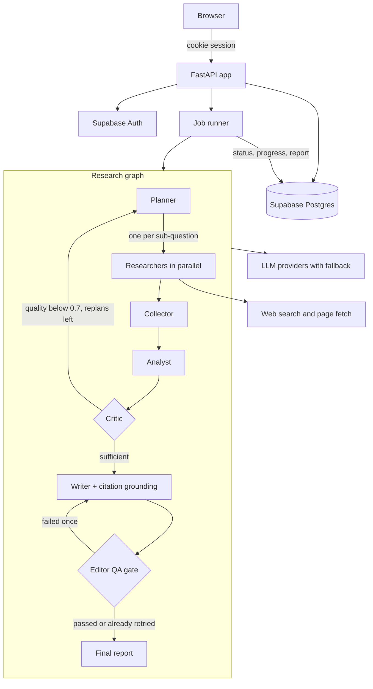
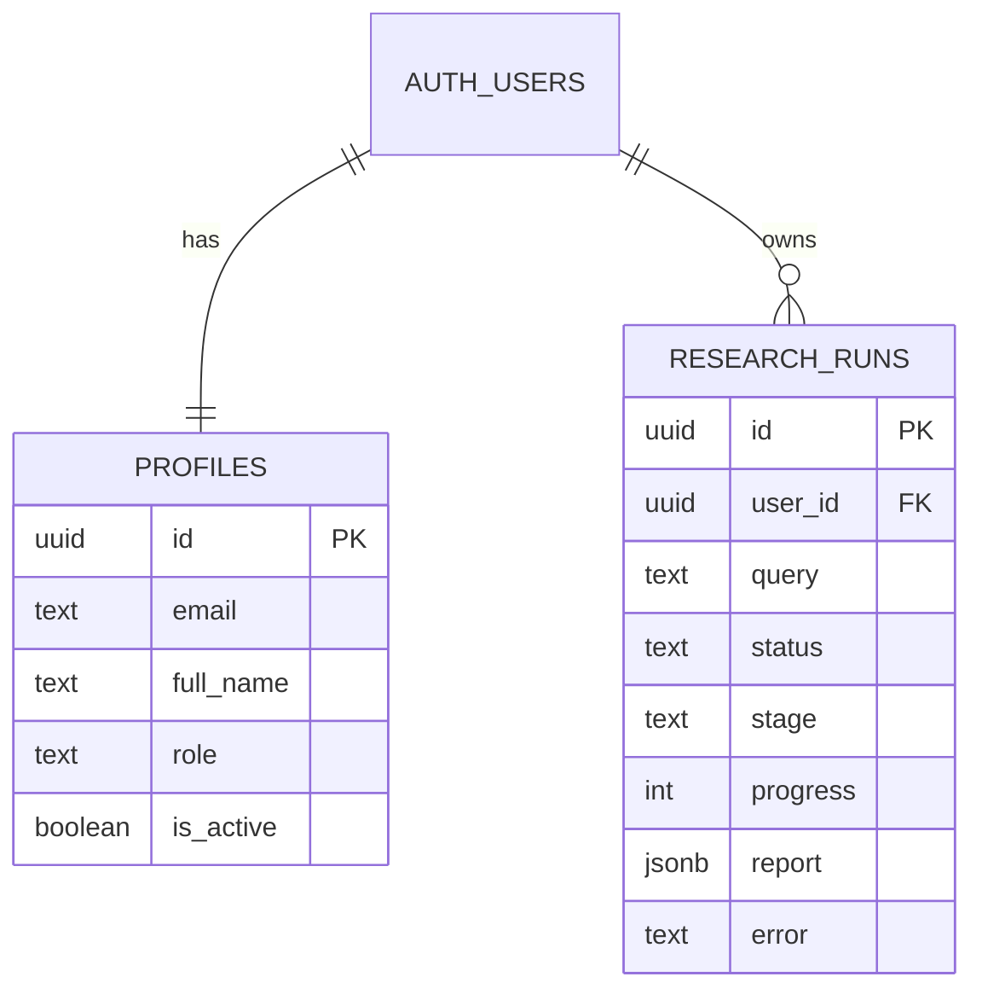

# Multi-Agent Deep Research System

## Overview

A multi-user research assistant. Each signed-in user can start research runs in which seven cooperating agents turn a question into a cited report: a Planner splits the question into sub-questions, one Researcher per sub-question searches the web in parallel, an Analyst synthesises the evidence, a Critic verifies claims and can send the run back for replanning, a Writer drafts the report and an Editor gates it on quality.

Runs execute on the server in the background, so a user can start several, close the browser and come back. A dashboard shows what is running and everything that has finished. Accounts, runs and reports are stored in Supabase.

Built with LangGraph, FastAPI, Pydantic and Supabase (Auth and Postgres). The frontend is dependency-free HTML, CSS and JavaScript served by the same FastAPI app.

## Problem Statement

A single LLM call answers a research question from memory: it cannot show its sources, it does not check its own claims, and it fails silently when its evidence is thin. This system separates the work into roles that check each other, grounds every citation in a page that was actually retrieved, makes the process observable, and keeps each user's work private and persistent.

## Key Features

- **Accounts.** Registration with email confirmation, sign-in, sign-out and password reset through Supabase Auth. Sessions are HttpOnly cookies; no token is exposed to page scripts.
- **Background runs.** A run belongs to the server, not to a browser tab. Several can run at once (per-user and global limits; extra runs queue).
- **Runs that cannot hang.** Every run has a wall-clock time limit, every exit path writes a final status, cancellation is immediate, and runs left active by a server restart are closed at start-up.
- **Dashboard.** Totals, in-progress runs with live stage and progress, and a searchable, filterable list of all research with cancel, run-again and delete.
- **Live pipeline view.** Open any run to watch each agent, including every parallel Researcher. Opening a run that is already in progress replays what happened so far.
- **Parallel fan-out.** Sub-questions are dispatched with LangGraph's `Send` API, one Researcher each.
- **Critic-driven replanning.** A quality score below 0.7 with fixable gaps loops the run back to the Planner (capped by `max_replan_iterations`, default 2).
- **Editor QA gate with one retry.** A failed draft returns to the Writer once, with the Editor's objections. Word count, citation coverage and section completeness are measured in code, not estimated by the model.
- **Grounded citations.** Any `[n]` that does not match a retrieved source is removed and the source list is rebuilt from the Researchers' evidence. If no sources were retrieved at all, the run fails with an explanation instead of writing from the model's memory.
- **Provider fallback.** Each agent role has a primary LLM provider and fallbacks. A provider without a key is skipped, and a failed call (rate limit, outage) is retried on the next provider.
- **Downloads.** PDF (print layout through the browser's print dialog), a self-contained HTML document, and Markdown.
- **User management.** Administrators can change roles, deactivate or delete accounts.
- **Configuration diagnostics.** Mis-pasted keys are reported by name at start-up and on a setup banner, without revealing their values.

## System Architecture

A modular monolith: one FastAPI process hosts the HTTP API, the static UI, the compiled LangGraph state machine and the background job runner. Supabase provides authentication and the database.

| Layer | Location | Responsibility |
|---|---|---|
| HTTP API | `api/main.py` | Routes, request validation, rate limiting |
| Sessions | `utils/auth.py` | Cookie sessions, token refresh, roles, CSRF origin check |
| Supabase client | `utils/supabase.py` | Auth (GoTrue) and database (PostgREST) calls over HTTPS |
| Data access | `utils/repository.py` | Profiles and runs; every user query is filtered by user id |
| Job runner | `utils/jobs.py` | Background execution, concurrency, time limit, cancellation, event buffer |
| Event contract | `utils/sse.py` | Translates graph execution into progress events |
| Orchestration | `graph/build_graph.py`, `graph/state.py` | Graph wiring, routing, shared state |
| Agents | `graph/nodes/` | One module per agent |
| Guardrails | `utils/report_quality.py` | Evidence digest, citation grounding, measured QA |
| Export | `utils/report_export.py` | Markdown and HTML rendering |
| Tools | `tools/` | Web search (Tavily, keyless fallback), page fetch with SSRF guard |
| LLM access | `utils/llm_router.py` | Role-based provider selection and runtime fallback |
| Diagnostics | `utils/config_check.py` | Credential format checks |
| Contracts | `schemas/` | Pydantic models for every agent's output |
| Frontend | `templates/index.html`, `static/` | UI |

Key decisions:

- **Runs are asyncio tasks in the API process.** This is the simplest design that lets runs outlive a request. The cost is that the app must run as one long-lived process with one worker; it cannot run on serverless platforms. A separate worker and queue would lift that limit (see Roadmap).
- **Supabase is called over its REST APIs with httpx.** No SDK is needed, and the test suite can replace the transport with an in-memory implementation while exercising the real client code.
- **The server uses the service-role key and enforces ownership in code.** Background jobs outlive a user's access token, so they cannot act with it. Row Level Security is still enabled as a second layer for the anon and authenticated keys.
- **Progress events are buffered in memory; durable state is in the database.** Status, stage, progress and the report are written to Postgres as the run advances; the detailed event history exists only while the run is in memory.
- **No frontend framework or third-party scripts.** This allows a `script-src 'self'` Content Security Policy.

## Architecture Diagram



## Technology Stack

| Area | Technology |
|---|---|
| Language | Python 3.11+ (CI runs 3.12) |
| Orchestration | LangGraph 1.x, LangChain core |
| API | FastAPI, Uvicorn, Server-Sent Events |
| Auth and database | Supabase Auth, Supabase Postgres |
| Validation | Pydantic v2, pydantic-settings |
| LLM providers | Groq, Google Gemini, OpenRouter |
| Search and fetch | Tavily, ddgs (keyless fallback), httpx, trafilatura |
| Frontend | HTML, CSS, JavaScript (no build step, no libraries) |
| Tests and lint | pytest, pytest-asyncio, ruff |
| Packaging | Docker, Docker Compose |

## Directory Structure

```text
api/main.py              FastAPI app and routes
config/settings.yaml     Non-secret configuration (models, limits)
config/settings.py       Settings loader
graph/                   Graph wiring, state, and one node per agent
schemas/                 Pydantic output contracts
supabase/schema.sql      Database schema, trigger and RLS policies
tools/                   search_tool.py, web_fetch.py
utils/auth.py            Sessions and roles
utils/supabase.py        Supabase REST client
utils/repository.py      Data access
utils/jobs.py            Background job runner
utils/sse.py             Progress event contract
utils/report_quality.py  Citation grounding and measured QA
utils/report_export.py   Markdown and HTML exporters
utils/llm_router.py      Provider routing and fallback
utils/config_check.py    Credential diagnostics
templates/, static/      Web UI
tests/                   Automated tests (offline)
scripts/dev_demo_server.py  Offline UI demo (in-memory data, mock agents)
evals/                   Pipeline evaluation harness
```

`utils/cache.py`, `utils/memory.py` and `schemas/report_schema.py` are present but not used by the pipeline.

## Prerequisites

- Python 3.11 or newer
- A Supabase project (the free tier is sufficient)
- An API key for at least one LLM provider: Groq, Gemini or OpenRouter
- Recommended: a Tavily API key for reliable web search
- Optional: Docker

## Installation

```bash
git clone https://github.com/ayelefransi/A-production-ready-Multi-Agent-Deep-Research-System.git
cd A-production-ready-Multi-Agent-Deep-Research-System
python -m venv venv
source venv/bin/activate        # Windows: venv\Scripts\activate
pip install -r requirements.txt
cp .env.example .env
```

Set up Supabase:

1. Create a project at supabase.com.
2. Open the SQL editor, paste the contents of `supabase/schema.sql` and run it.
3. In Authentication, URL configuration, set the site URL to the address the app will run at (for local use, `http://localhost:8000`). Confirmation and reset emails link back to it.
4. Copy the project URL and the two API keys into `.env` (see below).

## Environment Variables

Real values go in `.env`, which is git-ignored. `.env.example` is committed and must only ever contain placeholders.

| Variable | Required | Purpose |
|---|---|---|
| `SUPABASE_URL` | Yes | Project URL, for example `https://abcdefgh.supabase.co` |
| `SUPABASE_ANON_KEY` | Yes | Publishable key (`sb_publishable_...`) or legacy anon key |
| `SUPABASE_SERVICE_ROLE_KEY` | Yes | Secret key (`sb_secret_...`) or legacy service_role key. Server-side only |
| `ADMIN_EMAILS` | Recommended | Comma-separated emails promoted to administrator when they sign in |
| `SITE_URL` | Recommended | Public URL of the app, used as the redirect target in auth emails |
| `GROQ_API_KEY` | One LLM key is required | Groq |
| `GEMINI_API_KEY` | See above | Gemini |
| `OPENROUTER_API_KEY` | See above | OpenRouter |
| `TAVILY_API_KEY` | Recommended | Tavily search. Without it a keyless fallback is used, which public search engines often throttle |
| `REQUIRE_HUMAN_APPROVAL` | No | `true` pauses each run for approval before analysis |
| `RATE_LIMIT_PER_MINUTE` | No | Research starts per user per minute (default 10) |
| `MOCK_MODE` | No | Tests and demos only: canned agent output, no API calls |

## Configuration

Non-secret settings live in `config/settings.yaml`:

- `llm.providers`: the model id per provider. Model ids change often; if a provider answers "model not found", list its current models and update the id.
- `llm.roles`: the primary provider, fallbacks and temperature for each agent.
- `research`: `max_replan_iterations`, `enable_critic`, `enable_editor`, the approval checkpoint.
- `runs`: `timeout_seconds` (default 900), `llm_timeout_seconds` (90), `max_concurrent` (4), `max_active_per_user` (3), `approval_timeout_seconds` (600).
- `api`: query length and rate limits.

Any top-level setting can be overridden by an upper-case environment variable.

## Usage

```bash
uvicorn api.main:app --host 0.0.0.0 --port 8000
```

Open http://localhost:8000, create an account, confirm the email and sign in. Start a run from **New research**; follow it live or return to the **Dashboard**. A finished report offers **Download** as PDF, HTML or Markdown. Accounts listed in `ADMIN_EMAILS` also get a **Users** page.

To explore the interface without any accounts or keys:

```bash
python scripts/dev_demo_server.py
```

This demo uses an in-memory database and mock agents. Nothing in it is real or persistent; it prints its two demo sign-ins on start-up.

## API Documentation

Interactive OpenAPI docs are served at `/docs`. All `/runs` and `/admin` routes require a signed-in session.

| Method | Path | Description |
|---|---|---|
| `GET` | `/health` | Readiness: database, LLM providers, configuration problems |
| `POST` | `/auth/register` | Create an account |
| `POST` | `/auth/login` | Sign in (sets session cookies) |
| `POST` | `/auth/logout` | Sign out |
| `GET` | `/auth/me` | The signed-in user |
| `POST` | `/auth/forgot` | Send a password-reset email |
| `POST` | `/auth/reset` | Set a new password using a reset link's token |
| `POST` | `/auth/session` | Complete an email-link sign-in |
| `POST` | `/runs` | Start a run in the background (returns `202`) |
| `GET` | `/runs` | The user's runs, newest first |
| `GET` | `/runs/{id}` | One run with its report |
| `GET` | `/runs/{id}/events` | Progress as Server-Sent Events: history, then live |
| `POST` | `/runs/{id}/cancel` | Cancel an active run |
| `POST` | `/runs/{id}/retry` | Start a new run with the same question |
| `POST` | `/runs/{id}/decision` | Approve or reject a run awaiting approval |
| `DELETE` | `/runs/{id}` | Delete a run |
| `GET` | `/runs/{id}/export/{markdown\|html}` | Download the report |
| `GET` | `/admin/users` | List users (admin) |
| `PATCH` | `/admin/users/{id}` | Change role or active flag (admin) |
| `DELETE` | `/admin/users/{id}` | Delete an account and its runs (admin) |

Status codes: `401` not signed in, `403` deactivated or not an admin, `404` not found or owned by someone else, `409` run limit reached or wrong state, `422` invalid input, `429` rate limited, `503` database or LLM provider not configured.

Progress events: `queued`, `research_start`, `agent_start`, `agent_complete`, `planner_preview`, `researcher_task_complete`, `researcher_preview`, `analyst_preview`, `critic_preview`, `replan`, `writer_preview`, `editor_preview`, `writer_retry`, `human_approval_required`, `approved`, and one terminal event: `complete`, `error` or `cancelled`.

## Database Architecture

Defined in `supabase/schema.sql`.



- `profiles` holds the application role and active flag. A trigger creates the row when a user signs up.
- `research_runs` holds one row per request: status (`queued`, `running`, `awaiting_approval`, `completed`, `failed`, `cancelled`), current stage, progress, the failure reason and the report as JSONB. It is indexed on `(user_id, created_at desc)` for the dashboard and on `status` for start-up recovery.
- Both tables cascade on user deletion.
- Row Level Security is enabled on both tables with owner-only read policies. Only the server's service-role key can write.
- Backups are Supabase's responsibility and depend on your Supabase plan.

## Testing

All tests run offline: the LLM and search are mocked, and Supabase is replaced by an in-memory implementation of its REST API plugged in as the HTTP transport of the real client.

```bash
pip install -r requirements-dev.txt
ruff check .
pytest
python evals/evaluator.py --mock
```

The suite (88 tests) covers:

- **Accounts:** registration, confirmation, sign-in, sign-out, token refresh, password reset, no account enumeration, cross-site request blocking.
- **Runs:** background completion and persistence, results after a new sign-in, repeated runs without restart, concurrent runs, queuing at capacity, per-user limits, event replay for late subscribers.
- **Nothing gets stuck:** cancellation, the time limit, crashes that do not leak internals, no-evidence failure, a database outage mid-run, recovery of runs orphaned by a restart.
- **Isolation:** one user cannot read, cancel, retry, export or delete another's run.
- **Administration:** access control, deactivate, promote, delete, guard rails on one's own account.
- **Pipeline:** fan-out, replan loop and cap, writer retry, routing, citation grounding, measured QA, export escaping.
- **Live path without network:** provider readiness, placeholder keys, runtime provider fallback, keyless search engine chain.

What the suite does not prove: behaviour against a real Supabase project, and the quality of reports from real models. Check both in your own environment.

## Deployment

The app must run as **one long-lived process with one worker**, because runs and their progress events live in that process. Use a container host (Render, Railway, Fly.io, a VM). It does not run on serverless platforms such as Vercel; `vercel.json` in this repository is a leftover from the earlier single-request version and does not produce a working deployment.

```bash
cp .env.example .env   # add real values
docker compose up --build
```

- The image runs as a non-root user, exposes port 8000 and has a health check on `/health`.
- Set the environment variables in the host's secret store rather than shipping a `.env` file.
- Set `SITE_URL` and the Supabase site URL to the public address.
- Terminate TLS in front of the app and forward `X-Forwarded-Proto`, so session cookies are marked `Secure`.
- Do not scale to more than one replica.

**CI.** `.github/workflows/ci.yml` runs ruff, the test suite and the mock evaluation on pushes and pull requests to `main`.

**Recovery.** Restart the container. On start-up, runs that were in progress are marked failed with an explanation and can be started again from the dashboard. All finished reports are in the database.

## Security Considerations

| Area | Status |
|---|---|
| Authentication | Supabase Auth; HttpOnly, SameSite=Lax session cookies; tokens never reach page scripts |
| Authorisation | Every run query is filtered by the signed-in user's id; admin routes check the role; RLS as a second layer |
| CSRF | SameSite cookies plus an Origin check on state-changing requests |
| Brute force | Sign-in and sign-up are rate limited per client IP; Supabase applies its own limits |
| Secrets | Environment only; `.env` is git-ignored; the service-role key is never sent to the browser |
| Input validation | Pydantic models on every route; UUID path parameters |
| Cross-site scripting | The UI inserts all model and web text as text nodes; only `http(s)` links are clickable; exports escape all text |
| Content Security Policy | `script-src 'self'` on the UI; downloads are served with a policy that permits no script |
| Server-side request forgery | Page fetches allow only `http(s)` URLs resolving to public addresses and re-validate redirects |
| Error handling | Clients get a generic message and a reference; details stay in the log |

Known gaps:

- **The service-role key bypasses RLS.** Ownership depends on the filters in `utils/repository.py`; a new query that omits the user id would expose data. Keep data access in that module.
- **Rate limits are per process** and keyed on the direct peer address. Behind a proxy, enforce limits at the edge.
- **DNS rebinding.** The SSRF guard resolves a host before the HTTP client connects.
- **Prompt injection.** Retrieved pages are passed to the models and can influence report text; citation grounding prevents invented sources only.
- **Dependencies** are minimum versions, not pinned with hashes.

## Troubleshooting

| Symptom | Cause and fix |
|---|---|
| "Setup needed" banner | Read it: it names the missing or malformed key. `/health` lists the same problems |
| `500 FUNCTION_INVOCATION_FAILED` on Vercel | The app cannot run on Vercel. Use a container host |
| Database errors with `/rest/v1/rest/v1` in the log | `SUPABASE_URL` should be the project URL only |
| Sign-in says "Confirm your email address first" | Open the confirmation email. If the link opens the wrong site, fix the site URL in Supabase and `SITE_URL` |
| `model ... does not exist` | The provider retired the model. Update `llm.providers.<name>.model` in `config/settings.yaml` |
| A run fails with "No sources could be retrieved" | The keyless search fallback was throttled. Set `TAVILY_API_KEY` |
| A run fails with "time limit" | Raise `runs.timeout_seconds`, or check provider rate limits in the log |
| Runs are marked failed after a restart | Expected: in-progress runs cannot survive a restart. Start them again |

## Roadmap

- A separate worker process and queue, so runs survive restarts and the app can scale beyond one replica
- Persisted progress events, so the detailed run history is available after the fact
- An evaluation set with reference answers, to measure factual accuracy
- Token and cost tracking per run and per user
- Pinned dependency versions
- Remove or wire in the unused `utils/cache.py` and `utils/memory.py`

## Contributing

1. Create a branch from `main`.
2. Install `requirements-dev.txt`.
3. Make the change with tests. `ruff check .` and `pytest` must pass.
4. Never commit real credentials; `.env.example` holds placeholders only.
5. Open a pull request describing the change and how you verified it.

## License

No license file is included in this repository. Until one is added, all rights are reserved by the author.
